# Diagrama Entidad-Relación — ComiTrack

Generado a partir de [`backend/db/schema.sql`](../backend/db/schema.sql) (estado final, con todos los `ALTER TABLE` aplicados).
15 tablas funcionales · PostgreSQL.

Se excluyen 4 tablas que existen en el esquema pero no son funcionales hoy: `encomiendas`, `historial_encomiendas`, `pasajeros` y `viaje_pasajero` (ver `docs/reporte-base-de-datos.pdf`).

> Para verlo: GitHub lo renderiza directo. En VS Code, con la extensión *Markdown Preview Mermaid Support*.
> Para exportar a PNG/SVG: abrir `diagrama-entidad-relacion.mmd`, copiar todo y pegarlo en https://mermaid.live.

## Diagrama completo

```mermaid
erDiagram
    %% ===================== USUARIOS Y ROLES =====================
    usuarios {
        int         id PK
        varchar     nombre
        varchar     apellido
        varchar     email UK
        varchar     dni UK "unico si no es NULL"
        varchar     password_hash
        varchar     rol "comisionista | cliente | administrador"
        bool        activo
        varchar     reset_token
        timestamp   reset_token_expira
        bool        email_verificado
        int         login_failed_attempts
        int         login_lock_level
        timestamptz login_locked_until
        timestamp   creado_en
    }

    clientes {
        int       id PK
        int       usuario_id FK, UK
        varchar   dni "legado: canonico en usuarios"
        varchar   telefono
        text      foto_perfil
        bool      primera_solicitud_encomienda_realizada
        timestamp creado_en
    }

    comisionistas {
        int       id PK
        int       usuario_id FK, UK
        varchar   dni "legado: canonico en usuarios"
        varchar   telefono
        text      presentacion
        text      foto_perfil
        numeric   precio_km
        numeric   monto_minimo_encomienda_chica
        numeric   monto_minimo_encomienda_mediana
        numeric   monto_minimo_encomienda_grande
        timestamp creado_en
    }

    verificaciones_identidad {
        int         id PK
        int         usuario_id FK
        varchar     estado "NO_INICIADA | EN_PROCESO | PENDIENTE_REVISION | APROBADA_MANUALMENTE | RECHAZADA | REQUIERE_CORRECCION"
        timestamptz consentimiento_en
        varchar     dni_parcial
        varchar     resultado_ocr "legible | requiere_revision | no_legible"
        jsonb       coincidencias
        jsonb       controles_faciales
        timestamptz iniciada_en
        timestamptz actualizada_en
        timestamptz enviada_en
        timestamptz resuelta_en
        int         resuelta_por FK "admin que resuelve"
        varchar     motivo_resolucion
    }

    opiniones {
        int         id PK
        int         usuario_id FK
        varchar     texto
        timestamptz creado_en
    }

    notificaciones {
        int         id PK
        int         usuario_id FK
        int         viaje_id FK "nullable"
        varchar     titulo
        text        mensaje
        timestamptz leida_en
        timestamptz creado_en
    }

    %% ===================== VIAJES =====================
    viajes {
        int         id PK
        int         usuario_id FK "comisionista"
        varchar     origen
        varchar     destino
        date        fecha
        time        hora_salida
        time        hora_llegada
        numeric     distancia_km
        int         duracion_min
        uuid        serie_id "agrupa viajes repetidos"
        varchar     repeticion_dias
        int         cupo_total
        varchar     estado "programado | en_curso | finalizado | cancelado"
        timestamptz iniciado_en
        timestamptz finalizado_en
        timestamp   creado_en
    }

    paradas_viaje {
        int       id PK
        int       viaje_id FK
        int       orden "UK con viaje_id"
        varchar   localidad "UK con viaje_id"
        time      hora_estimada
        timestamp creado_en
    }

    recordatorios_viaje {
        int         id PK
        int         viaje_id FK, UK
        int         minutos_anticipacion
        timestamptz programado_para
        varchar     estado "pendiente | procesando | enviado | cancelado"
        timestamptz procesamiento_iniciado_en
        timestamptz enviado_en
        timestamptz creado_en
        timestamptz actualizado_en
    }

    %% ===================== SOLICITUDES (flujo actual) =====================
    solicitudes_viaje {
        int         id PK
        int         viaje_id FK
        int         cliente_id FK
        varchar     tipo "pasajero | encomienda"
        varchar     estado "pendiente | aceptada | rechazada | cancelada"
        varchar     origen_calle
        varchar     origen_altura
        varchar     origen_barrio "legado"
        varchar     origen_codigo_postal
        varchar     origen_descripcion
        varchar     origen_localidad
        varchar     destino_calle
        varchar     destino_altura
        varchar     destino_barrio "legado"
        varchar     destino_codigo_postal
        varchar     destino_localidad
        varchar     nombre "pasajero"
        varchar     apellido "pasajero"
        varchar     dni "pasajero"
        varchar     telefono "pasajero"
        bool        lleva_equipaje "pasajero"
        varchar     equipaje_detalle "pasajero"
        int         cantidad_pasajeros "pasajero"
        varchar     estado_pasajero "a_bordo | en_destino | ausente | cancelado_comisionista"
        timestamptz subio_en
        timestamptz llego_en
        numeric     peso_kg "encomienda"
        numeric     ancho_cm "encomienda"
        numeric     largo_cm "encomienda"
        numeric     profundidad_cm "encomienda"
        varchar     tamano "pequeno | mediano | grande"
        bool        fragil "encomienda"
        varchar     tipo_contenido "encomienda"
        varchar     contenido_descripcion "encomienda"
        varchar     emisor_nombre
        varchar     emisor_apellido
        varchar     emisor_telefono
        varchar     receptor_nombre
        varchar     receptor_apellido
        varchar     receptor_telefono
        timestamptz retirada_en
        timestamptz entregada_en
        varchar     forma_pago "efectivo | transferencia"
        numeric     distancia_km "km del tramo"
        numeric     precio_km
        numeric     monto
        varchar     motivo_rechazo
        timestamp   creado_en
        timestamp   resuelto_en
    }

    historial_solicitudes_encomienda {
        int         id PK
        int         solicitud_id FK
        varchar     estado "pendiente | aceptada | rechazada | cancelada | retirada | entregada"
        timestamptz fecha_hora
    }

    %% ===================== FINANZAS =====================
    ingresos {
        int         id PK
        int         viaje_id FK "nullable"
        int         usuario_id FK "comisionista"
        int         solicitud_id FK "1 activo por solicitud"
        varchar     concepto
        numeric     monto
        date        fecha
        varchar     tipo_servicio "pasajero | encomienda"
        varchar     forma_pago "efectivo | transferencia"
        varchar     estado "activo | anulado"
        varchar     motivo_anulacion
        timestamptz anulado_en
        timestamptz creado_en
        timestamptz actualizado_en
    }

    tipos_gasto {
        int         id PK
        int         usuario_id FK "UK con lower(nombre)"
        varchar     nombre
        varchar     descripcion
        timestamptz creado_en
        timestamptz actualizado_en
    }

    gastos {
        int         id PK
        int         viaje_id FK "nullable"
        int         usuario_id FK
        int         tipo_gasto_id FK
        varchar     categoria "legado"
        numeric     monto
        date        fecha
        varchar     descripcion
        timestamptz creado_en
        timestamptz actualizado_en
    }

    reportes_rentabilidad {
        bigint      id PK
        int         usuario_id FK
        date        periodo_desde
        date        periodo_hasta
        timestamptz generado_en
        numeric     total_ingresos
        numeric     total_gastos
        numeric     resultado_economico
        smallint    version_snapshot
        jsonb       datos_snapshot "snapshot inmutable"
    }

    %% ===================== RELACIONES =====================
    usuarios ||--o| clientes                    : "es"
    usuarios ||--o| comisionistas               : "es"
    usuarios ||--o{ verificaciones_identidad    : "solicita"
    usuarios |o--o{ verificaciones_identidad    : "resuelve"
    usuarios ||--o{ opiniones                   : "publica"
    usuarios ||--o{ notificaciones              : "recibe"

    usuarios ||--o{ viajes                      : "publica"
    viajes   ||--o{ paradas_viaje               : "tiene"
    viajes   ||--o| recordatorios_viaje         : "programa"
    viajes   |o--o{ notificaciones              : "origina"

    viajes   ||--o{ solicitudes_viaje           : "recibe"
    clientes ||--o{ solicitudes_viaje           : "realiza"
    solicitudes_viaje ||--o{ historial_solicitudes_encomienda : "registra"

    usuarios |o--o{ ingresos                    : "cobra"
    viajes   |o--o{ ingresos                    : "genera"
    solicitudes_viaje |o--o{ ingresos           : "se cobra en"

    usuarios    ||--o{ tipos_gasto              : "define"
    tipos_gasto ||--o{ gastos                   : "clasifica"
    usuarios    ||--o{ gastos                   : "registra"
    viajes      |o--o{ gastos                   : "imputa"

    usuarios ||--o{ reportes_rentabilidad       : "genera"
```

## Relaciones y cardinalidad

| Relación | Cardinalidad | FK | ON DELETE |
|---|---|---|---|
| usuarios → clientes | 1 : 0..1 | `clientes.usuario_id` (UNIQUE) | CASCADE |
| usuarios → comisionistas | 1 : 0..1 | `comisionistas.usuario_id` (UNIQUE) | CASCADE |
| usuarios → viajes | 1 : N | `viajes.usuario_id` | CASCADE |
| viajes → paradas_viaje | 1 : N | `paradas_viaje.viaje_id` | CASCADE |
| viajes → recordatorios_viaje | 1 : 0..1 | `recordatorios_viaje.viaje_id` (UNIQUE) | CASCADE |
| usuarios → notificaciones | 1 : N | `notificaciones.usuario_id` | CASCADE |
| viajes → notificaciones | 0..1 : N | `notificaciones.viaje_id` | SET NULL |
| viajes → solicitudes_viaje | 1 : N | `solicitudes_viaje.viaje_id` | CASCADE |
| clientes → solicitudes_viaje | 1 : N | `solicitudes_viaje.cliente_id` | CASCADE |
| solicitudes_viaje → historial_solicitudes_encomienda | 1 : N | `solicitud_id` | CASCADE |
| usuarios → ingresos | 0..1 : N | `ingresos.usuario_id` | CASCADE |
| viajes → ingresos | 0..1 : N | `ingresos.viaje_id` | CASCADE |
| solicitudes_viaje → ingresos | 0..1 : N (máx. 1 `activo`) | `ingresos.solicitud_id` | SET NULL |
| usuarios → tipos_gasto | 1 : N | `tipos_gasto.usuario_id` | CASCADE |
| tipos_gasto → gastos | 1 : N | `gastos.tipo_gasto_id` | RESTRICT (default) |
| usuarios → gastos | 1 : N | `gastos.usuario_id` | CASCADE |
| viajes → gastos | 0..1 : N | `gastos.viaje_id` | CASCADE |
| usuarios → verificaciones_identidad | 1 : N (máx. 1 activa) | `usuario_id` | CASCADE |
| usuarios (admin) → verificaciones_identidad | 0..1 : N | `resuelta_por` | SET NULL |
| usuarios → reportes_rentabilidad | 1 : N | `usuario_id` | CASCADE |
| usuarios → opiniones | 1 : N | `usuario_id` | CASCADE |

## Notas del modelo

- **Rol por especialización:** `usuarios` es la entidad general; `clientes` y `comisionistas` son subtipos 1:1 (discriminados por `usuarios.rol`). Los `administrador` no tienen tabla propia.
- **Viajes, gastos, ingresos y reportes apuntan a `usuarios`**, no a `comisionistas`: el dueño se identifica por `usuario_id`.
- **Solicitudes:** pasajeros y encomiendas se gestionan en `solicitudes_viaje`, discriminados por `tipo`. Los datos del paquete (peso, medidas, fragilidad, contenido, emisor y receptor) se guardan en columnas de la propia solicitud.
- **Trigger:** `solicitudes_encomienda_historial_estado` inserta automáticamente en `historial_solicitudes_encomienda` cada vez que cambia el estado de una solicitud de encomienda o se registra su retiro o entrega.
- **Columnas legadas:** `clientes.dni`, `comisionistas.dni` (el canónico es `usuarios.dni`), `gastos.categoria` (reemplazada por `tipo_gasto_id`), `solicitudes_viaje.origen_barrio`/`destino_barrio` (reemplazadas por código postal).
- **Índices únicos parciales:** `usuarios.dni` (si no es NULL), `ingresos.solicitud_id` (si `estado = 'activo'`), `verificaciones_identidad.usuario_id` (si está `EN_PROCESO` o `PENDIENTE_REVISION`).
